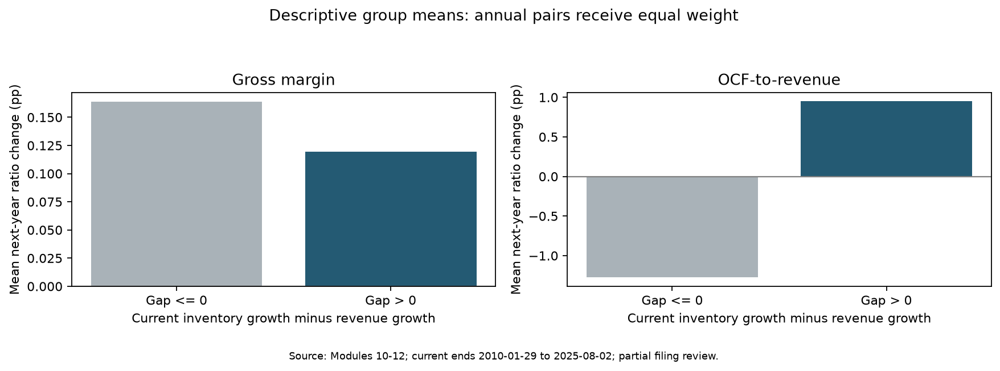
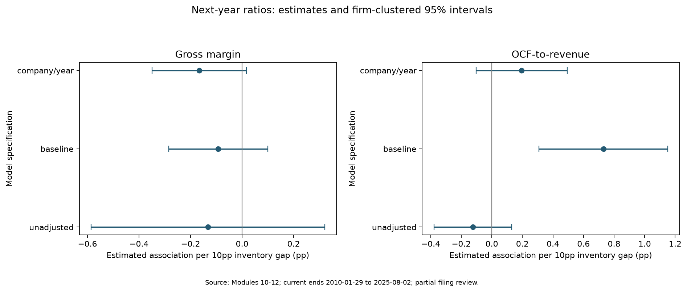
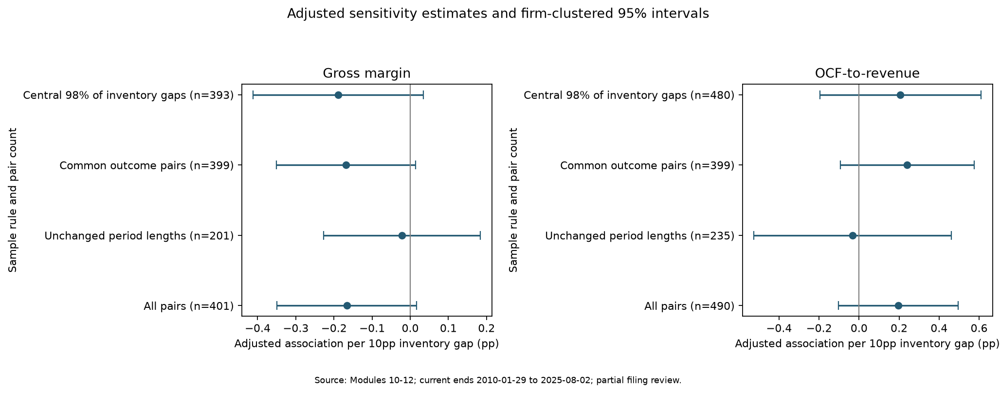

# Inventory Growth and Subsequent Operating Performance

Final report | Historical associations | Partial filing review | Report date: 2026-10-11

Selected U.S.-listed merchandise retailers and consumer brands.

## Executive Summary

This project studies inventory growth relative to revenue growth and subsequent operating performance among 42 manually selected U.S.-listed merchandise retailers and consumer brands. It uses 656 annual records, separate gross-margin and OCF-to-revenue research samples, and 399 common outcome pairs.

Gross margin: a 10 percentage-point inventory-growth gap is associated with -0.1663 percentage points in the next-year ratio, conditional on the controls (95% interval -0.3491 to +0.0164). The 95% interval includes zero; the estimate remains imprecise.

OCF-to-revenue: a 10 percentage-point inventory-growth gap is associated with +0.1955 percentage points in the next-year ratio, conditional on the controls (95% interval -0.1032 to +0.4943). The 95% interval includes zero; the estimate remains imprecise.

Filing review covers 2 company eligibility decisions, 7 annual rows and 3 of 7 selected cases. The statistical sample remains provisional. The adjusted specifications examined do not provide sufficiently precise evidence of a stable association. This does not establish that the true association is zero or that inventory information has no research value.

## Research Question and Economic Rationale

Does inventory growth exceeding revenue growth in year t relate to changes in gross margin and operating cash flow divided by revenue in year t+1?

Inventory-growth gap = (Inventory_t / Inventory_(t-1) - 1) - (Revenue_t / Revenue_(t-1) - 1). Growth differences are expressed in percentage points. Gross margin = reported gross profit / analysis revenue. OCF-to-revenue = operating cash flow / analysis revenue. Change outcomes equal the next-year ratio minus the current-year ratio.

Inventory accumulation may signal slower demand, subsequent markdowns or working-capital pressure. Expansion, acquisitions, deliberate replenishment and product mix can produce similar signals with different outcomes. A positive gap is a research flag whose interpretation requires context.

## Sample and Review Coverage

The 42-company candidate universe was manually assembled across five researcher-defined business groups: apparel/footwear/off-price, department stores, home/furniture/home improvement, sporting/electronics/other merchandise, and beauty/personal care. It is not a census, random sample or certified GICS classification. U.S. listing does not imply exclusively U.S. operations or pure retail revenue.

Company identity is mapped to SEC CIK. Company Facts JSON snapshots supply standard USD facts. Annual revenue periods in 10-K/10-K/A filings anchor the panel; the extraction matches periods and accession numbers, distinguishing flow measures from year-end balances. The earliest visible filing in the cached facts is an extraction rule, not historical point-in-time certification.

Outcome-specific usable annual coverage of at least five years, continuity, numeric checks and documented scope restrictions define an unbalanced panel. The pipeline preserves source tags, limited flagged derivations, original amounts and separate analysis values. Module 9 reconciled identified reporting differences, including DDS net-sales denominators and separately presented gross-profit charges. Other scope and classification differences remain subject to review.

Reviewed pairs denote recorded company eligibility plus prior/current/next annual-scope checks. This is a research review status, not an independent audit. No new metric values were assumed for pending decisions. Applied metric values: 0.

| Outcome | Pairs | Companies | Reviewed pairs | Current end from | Current end to | Latest target end | Before target start | Different lengths |
| --- | --- | --- | --- | --- | --- | --- | --- | --- |
| Gross margin | 401 | 36 | 3 | 2010-01-29 | 2025-08-02 | 2026-08-01 | 0 | 200 |
| OCF-to-revenue | 490 | 42 | 3 | 2010-01-29 | 2025-08-02 | 2026-08-01 | 0 | 255 |

| Review item | Reviewed | Total | Pending |
| --- | --- | --- | --- |
| Company eligibility | 2 | 42 | 40 |
| Annual scope | 7 | 656 | 649 |
| Selected cases | 3 | 7 | 4 |

## Methods

The project compares positive and nonpositive inventory gaps, examines correlations and company-level patterns, and estimates OLS models on company-year pairs. Company-balanced descriptive comparisons require at least three observations in each gap group for a company.

The main adjusted model explains the next-year ratio using inventory-growth gap, the current ratio, revenue growth, log total assets, company fixed effects and target-end-calendar-year fixed effects. Inference uses firm-clustered CRV1 covariance with small-sample corrections and t-based 95% intervals. The estimates are scaled to a 10 percentage-point inventory gap.

Current-ratio controls address starting-level differences and mean-reversion patterns. Baseline-controlled change and next-level specifications have an algebraic coefficient relationship; they are not independent replications. Company/year controls reduce some confounding but do not identify causal effects. Calendar-year effects do not fully align fiscal operating periods.

Sensitivity rules examine all pairs, periods without length changes exceeding three days, common outcome pairs, and central 98% of outcome-specific inventory gaps. Trimming uses the signal, not future outcomes. R-squared measures in-sample fit and is not predictive accuracy.

## Descriptive Results

The tables distinguish pooled annual-pair summaries from company-equal comparisons. Mean changes, median changes and decline frequencies capture different distribution features. A positive group difference means a more positive next-year change in Gap > 0 relative to Gap <= 0.

These descriptive differences are not causal effects and do not incorporate the full control set. A descriptive positive cash-flow association can coexist with an imprecise adjusted estimate; the full model comparison should be consulted.

| Outcome | Inventory group | Pairs | Mean change (pp) | Median change (pp) | Decline rate (%) |
| --- | --- | --- | --- | --- | --- |
| Gross margin | Gap <= 0 | 170 | 0.1638 | 0.071 | 47.0588 |
| Gross margin | Gap > 0 | 231 | 0.1195 | -0.1137 | 57.1429 |
| OCF-to-revenue | Gap <= 0 | 219 | -1.2761 | -0.8555 | 70.3196 |
| OCF-to-revenue | Gap > 0 | 271 | 0.9492 | 0.4192 | 41.6974 |

| Outcome | Eligible companies | Mean company difference (pp) | Median company difference (pp) | Share negative (%) |
| --- | --- | --- | --- | --- |
| Gross margin | 31 | 0.0287 | -0.1176 | 58.0645 |
| OCF-to-revenue | 36 | 2.7116 | 2.5988 | 13.8889 |

## Adjusted Regression Results

Gross margin: a 10 percentage-point inventory-growth gap is associated with -0.1663 percentage points in the next-year ratio, conditional on the controls (95% interval -0.3491 to +0.0164). The 95% interval includes zero; the estimate remains imprecise.

OCF-to-revenue: a 10 percentage-point inventory-growth gap is associated with +0.1955 percentage points in the next-year ratio, conditional on the controls (95% interval -0.1032 to +0.4943). The 95% interval includes zero; the estimate remains imprecise.

The fully adjusted estimates should be interpreted alongside the alternative control specifications in the figure. Any conclusion is conditional on the provisional sample, measured variables and inference assumptions.

| Outcome | Pairs | Companies | Association per 10pp (pp) | 95% lower (pp) | 95% upper (pp) |
| --- | --- | --- | --- | --- | --- |
| Gross margin | 401 | 36 | -0.1663 | -0.3491 | 0.0164 |
| OCF-to-revenue | 490 | 42 | 0.1955 | -0.1032 | 0.4943 |

## Sensitivity Analysis

Gross margin: 4 of 4 adjusted sensitivity intervals include zero. OCF-to-revenue: 4 of 4 adjusted sensitivity intervals include zero.

The adjusted specifications examined do not provide sufficiently precise evidence of a stable association. This does not establish that the true association is zero or that inventory information has no research value. Smaller subsets also change sample composition and precision. The four rules are sensitivity checks, not independent experiments.

| Outcome | Sample rule | Pairs | Companies | Association per 10pp (pp) | 95% lower (pp) | 95% upper (pp) |
| --- | --- | --- | --- | --- | --- | --- |
| Gross margin | All pairs | 401 | 36 | -0.1663 | -0.3491 | 0.0164 |
| Gross margin | Unchanged period lengths | 201 | 36 | -0.0216 | -0.2274 | 0.1842 |
| Gross margin | Common outcome pairs | 399 | 36 | -0.1688 | -0.3513 | 0.0137 |
| Gross margin | Central 98% of inventory gaps | 393 | 36 | -0.1889 | -0.4119 | 0.0341 |
| OCF-to-revenue | All pairs | 490 | 42 | 0.1955 | -0.1032 | 0.4943 |
| OCF-to-revenue | Unchanged period lengths | 235 | 42 | -0.0327 | -0.5259 | 0.4604 |
| OCF-to-revenue | Common outcome pairs | 399 | 36 | 0.2406 | -0.0938 | 0.5749 |
| OCF-to-revenue | Central 98% of inventory gaps | 480 | 42 | 0.207 | -0.1965 | 0.6106 |

## Filing-reviewed Cases

Cases were selected from available research pairs using subgroup maximum current gaps, a representative near the median positive gap, and the minimum gap. Selection did not use subsequent outcome direction, although entry into the research-pair pool depends on outcome-data availability. These purposefully selected cases cannot estimate population frequencies.

The table and evidence narratives include only cases marked reviewed. Management explanations, statement facts and research interpretation should be distinguished. Retain means no additional exclusion was justified by the recorded review; it does not certify causality.

| Ticker | Current period end | Inventory gap (pp) | Next GM change (pp) | Next OCF/revenue change (pp) | Decision | Three-year review passed |
| --- | --- | --- | --- | --- | --- | --- |
| SPWH | 2022-01-29 | 55.054 | 0.331 | 4.7795 | retain | True |
| URBN | 2011-01-31 | 5.9798 | -6.4004 | -5.5069 | retain | True |
| SPWH | 2021-01-30 | -75.423 | -0.2642 | -17.8859 | retain | True |

### SPWH | Current period end 2022-01-29 | Next period end 2023-01-28

**Units and scope:** FY2019-2022 each contain 52 weeks. Consolidated USD thousands converted to USD; weighted-average inventory. Store acquisitions and expansion affect growth comparisons. All 24 annual amounts checked; point-in-time availability not certified.

**Current drivers:** FY2021 MD&A pp.41,45: sales +3.7%, inventory +58.8%; deliberate inventory rebuilding. Ten new stores supported sales despite same-store sales -2.2%.

**Next-year drivers:** FY2022 MD&A pp.46,49 and cash flows p.62: sales -7.1%; margin improved with lower logistics costs and favorable product margins/mix. Inventory cash absorption fell from USD143.126m to USD12.568m; OCF recovered although net income fell.

**Review interpretation:** Reviewed 2026-10-09. Gap +55.0540pp; next GM change +0.3310pp; next OCF/revenue change +4.7795pp. Retain as a counterexample, not causal evidence. FY2021 Note 18: USD55m termination receipt affects the OCF baseline; reported OCF retained without normalization.

[Current annual filing](https://www.sec.gov/Archives/edgar/data/1132105/000155837022004698/spwh-20220129x10k.htm)

[Next annual filing](https://www.sec.gov/Archives/edgar/data/1132105/000095017023012621/spwh-20230128.htm)

### URBN | Current period end 2011-01-31 | Next period end 2012-01-31

**Units and scope:** January 31 year-end; USD thousands converted to USD. Consolidated retail and wholesale figures. Cost includes buying, distribution and occupancy. Three-year amounts reconciled; later comparative evidence does not certify point-in-time availability.

**Current drivers:** FY2011 MD&A p.33 (also FY2012 pp.31-32): sales grew 17.4%, inventory 23.3%. Management linked inventory growth to new-store stocking and direct-to-consumer expansion; comparable-store inventory rose 4.4%. The group-wide inventory gap therefore includes expansion.

**Next-year drivers:** FY2012 MD&A pp.31-32: markdowns on slow-moving apparel and occupancy-cost deleveraging reduced gross margin. Lower net income mainly explained lower operating cash flow. F-6 shows inventory cash absorption fell from USD43.372m to USD20.817m; it did not worsen.

**Review interpretation:** Reviewed 2026-10-09. Retain for retrospective analysis: gap +5.9798pp; next gross-margin change -6.4004pp; next OCF-margin change -5.5069pp. These observations do not establish causation. FY2012 statements corroborate FY2011 amounts; original filing availability remains uncertified.

[Current annual filing](https://www.sec.gov/Archives/edgar/data/912615/000119312511085784/d10k.htm)

[Next annual filing](https://www.sec.gov/Archives/edgar/data/912615/000119312512146029/d276682d10k.htm)

### SPWH | Current period end 2021-01-30 | Next period end 2022-01-29

**Units and scope:** FY2019-2022 each contain 52 weeks. Consolidated USD thousands converted to USD; weighted-average inventory. Store acquisitions and expansion affect growth comparisons. All 24 annual amounts checked; point-in-time availability not certified.

**Current drivers:** FY2020 MD&A pp.44,47: sales +63.8%, inventory -11.6%. Pandemic-related demand and store expansion supported sales. Higher income, inventory release and increased payables supported OCF. Cash-flow inventory movements exclude acquired amounts; they differ from balance-sheet changes.

**Next-year drivers:** FY2021 MD&A pp.41,45 and cash flows p.57: freight pressured margin; inventory rebuilding and reduced payables lowered OCF. Inventory cash flow changed from +USD39.938m to -USD143.126m.

**Review interpretation:** Reviewed 2026-10-09. Gap -75.4230pp; next GM change -0.2642pp; next OCF/revenue change -17.8859pp. Retain: pandemic demand and replenishment complicate interpretation. The next-year OCF includes a USD55m termination receipt (FY2021 Note 18); no normalization applied. Association, not causation.

[Current annual filing](https://www.sec.gov/Archives/edgar/data/1132105/000155837021003940/spwh-20210130x10k.htm)

[Next annual filing](https://www.sec.gov/Archives/edgar/data/1132105/000155837022004698/spwh-20220129x10k.htm)

## Research Limits and Remaining Work

The manually selected present-day candidate list can create selection and survivorship bias. Unbalanced history and outcome-dependent missingness affect generalization. Cost and gross-profit classifications differ across firms; fixed effects do not remove every accounting-comparability problem. Missing annual cost fields: 42; missing annual gross-profit fields: 108.

Filing review is partial. Pending selected cases: AKA, ARHS, ULTA, KSS. Most annual rows and company histories have not completed scope review. Recorded derivations and standard-tag selections do not constitute complete historical verification.

Current filings arrive 38-134 days after the target year begins in these retained samples. The design is retrospective and may overlap the target operating period. It is not a before-year-start forecast. Latest cached comparatives and incomplete historical information sets prevent point-in-time certification.

The project has no out-of-sample prediction validation, stock-return backtest or causal identification. Small business groups and a limited number of firm clusters constrain inference. Wide intervals can reflect limited precision; they do not prove absence of an effect.

Further work can complete pending case reviews, prioritize material missing fields, assess same-store sales and store expansion, and define an explicit filing-date-based forecast horizon before attempting predictive validation. These extensions are not claimed as completed in this version.

| Ticker | Current period end | Selection reason |
| --- | --- | --- |
| AKA | 2021-12-31 | Largest inventory gap within subgroup |
| ARHS | 2021-12-31 | Largest inventory gap within subgroup |
| ULTA | 2013-02-02 | Largest inventory gap within subgroup |
| KSS | 2013-02-02 | Largest inventory gap within subgroup |

## Practical Use and Conclusion

The practical contribution is a reproducible fundamental-research workflow connecting a transparent inventory signal to accounting checks, subsequent operating ratios and cited filing evidence. It can help prioritize companies for deeper investigation of demand, replenishment, expansion, vendor terms and cash-flow composition.

The adjusted specifications examined do not provide sufficiently precise evidence of a stable association. This does not establish that the true association is zero or that inventory information has no research value. Inventory-growth gaps should be interpreted with business context and a fuller information set. This version completes the analysis/report deliverable with explicit remaining-review limits; it does not establish a trading rule or validated prediction model.

## Sources and Reproduction

Primary inputs are cached SEC Company Facts and annual filings. Amounts use USD; growth rates and ratios are stored as decimals and displayed as percent or percentage points as labeled. Applied-review snapshot: 2026-10-09T22:34:44.929688+00:00. Statistical results were regenerated from that snapshot through Modules 10 and 11.

The companion source_manifest.json identifies every input file with a SHA-256 hash. Reviewed-case links below point to the original filings; detailed accounting and annual-scope evidence remain in the input audit tables. README.md describes execution order and deliverable structure. The report date labels this deliverable, not the underlying financial snapshot.

## Research Context and References

Gaur, Fisher, and Raman (2005) examine retail inventory turnover in relation to gross margin, capital intensity and sales surprise. Their study provides background for considering multiple operating factors when interpreting inventory metrics. The present project evaluates subsequent operating ratios using a different inventory-growth-gap measure.

SEC documentation describes the Company Facts API as aggregating standard-taxonomy facts applying to the entire filing entity. Custom-tag disclosures can therefore require direct filing review. The project records unresolved fields and selected filing evidence.

- [SEC: EDGAR Application Programming Interfaces](https://www.sec.gov/search-filings/edgar-application-programming-interfaces)

- [Gaur, Fisher, and Raman (2005). An Econometric Analysis of Inventory Turnover Performance in Retail Services. Management Science, 51(2), 181-194.](https://pubsonline.informs.org/doi/10.1287/mnsc.1040.0298)

